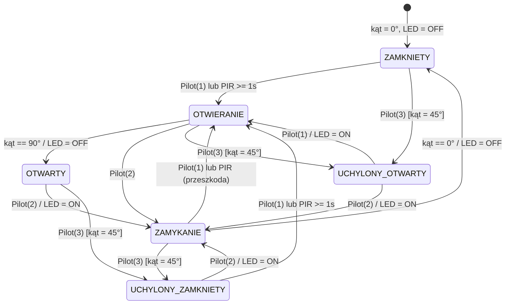

# Automatyczna Brama Dwuskrzydłowa – Maszyna Stanów (Arduino)

Projekt systemu sterowania automatyczną bramą dwuskrzydłową zrealizowany na platformie **Arduino Uno** z wykorzystaniem wzorca **Maszyny Stanów Skończonych (Finite State Machine – FSM)**. Program działa w pełni nieblokująco (bez użycia funkcji `delay()`, w oparciu o `millis()`), obsługując jednocześnie pilota podczerwieni (IR), czujnik ruchu PIR, dwa serwomechanizmy oraz oświetlenie ostrzegawcze LED.

---

## Funkcjonalności

* **6-stanowa maszyna stanów** zapewniająca przewidywalną i bezpieczną logikę pracy bramy.
* **Sterowanie bezprzewodowe (Pilot IR)** – pełne otwieranie, zamykanie oraz zatrzymanie w pozycji uchylonej.
* **Automatyka i bezpieczeństwo (Czujnik PIR)**:
  * Natychmiastowe zapalenie oświetlenia LED po wykryciu ruchu.
  * Automatyczne otwarcie bramy po **1 sekundzie** ciągłego wykrywania obecności.
  * Funkcja antyzgnieceniowa – natychmiastowe cofnięcie skrzydeł bramy w przypadku wykrycia przeszkody podczas zamykania.
* **Płynny, synchroniczny ruch skrzydeł** realizowany przez dwa serwomechanizmy pracujące przeciwbieżnie (`0°–90°` oraz `180°–90°`).

---

## Komponenty i połączenia (Pinout)

| Komponent | Pin Arduino | Opis funkcji |
| :--- | :---: | :--- |
| **Czujnik ruchu PIR** | `D2` | Wykrywanie obecności / przeszkody (`INPUT`) |
| **Serwomechanizm Lewy** | `D3` | Napęd lewego skrzydła bramy (`0°` = zamknięte, `90°` = otwarte) |
| **Serwomechanizm Prawy** | `D4` | Napęd prawego skrzydła bramy (`180°` = zamknięte, `90°` = otwarte) |
| **Dioda LED + Rezystor 220 Ω** | `D5` | Sygnalizacja świetlna ruchu bramy oraz wykrycia ruchu PIR |
| **Odbiornik podczerwieni (IR)** | `D6` | Odbiór komend z pilota IR |

> **Uwaga:** Dioda LED podłączona jest anodą (`+`) przez rezystor `220 Ω` do pinu `D5`, a katodą (`-`) do masy `GND`.

---

## Sterowanie pilotem IR

| Przycisk pilota | Kod HEX (Tinkercad) | Akcja |
| :---: | :---: | :--- |
| **`1`** | `0xEF10BF00` | Pełne otwarcie bramy (`OTWIERANIE` $\rightarrow$ `OTWARTY`) |
| **`2`** | `0xEE11BF00` | Pełne zamknięcie bramy (`ZAMYKANIE` $\rightarrow$ `ZAMKNIETY`) |
| **`3`** | `0xED12BF00` | Uchylenie bramy do kąta `45°` (`UCHYLONY_OTWARTY` lub `UCHYLONY_ZAMKNIETY`) |

---

## Architektura Maszyny Stanów (6 stanów)

1. **`ZAMKNIETY`** – Brama całkowicie zamknięta (`0°`), dioda LED zgaszona. Oczekiwanie na sygnał z pilota lub czujnika PIR.
2. **`OTWIERANIE`** – Płynny ruch skrzydeł w kierunku `90°`, dioda LED świeci ciągle.
3. **`OTWARTY`** – Brama całkowicie otwarta (`90°`), dioda LED wyłączona.
4. **`ZAMYKANIE`** – Płynny ruch skrzydeł w kierunku `0°`, dioda LED świeci ciągle. Aktywna ochrona PIR (cofnięcie w razie przeszkody).
5. **`UCHYLONY_OTWARTY`** – Pozycja pośrednia (`45°`) osiągnięta ze stanu zamkniętego lub podczas otwierania.
6. **`UCHYLONY_ZAMKNIETY`** – Pozycja pośrednia (`45°`) osiągnięta ze stanu otwartego lub podczas zamykania (z aktywnym wyzwalaniem PIR).

### Diagram przejść stanów

---

## Wymagane biblioteki

Projekt korzysta ze standardowych bibliotek Arduino (wbudowanych również w symulator **Autodesk Tinkercad**):
* `Servo.h`
* `IRremote.h`

---

## Uruchomienie

1. Otwórz projekt w środowisku **Arduino IDE** lub **Tinkercad Circuits**.
2. Połącz elementy zgodnie z tabelą wyprowadzeń powyżej.
3. Wgraj kod źródłowy na płytkę **Arduino Uno**.
4. Otwórz **Monitor Szeregowy (`9600 baud`)**, aby śledzić w czasie rzeczywistym zmiany stanów oraz odbierane kody HEX z pilota.
